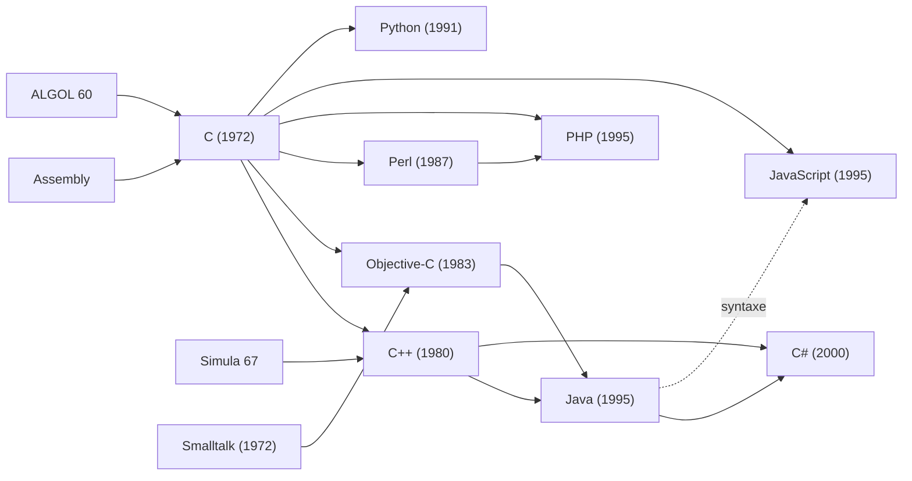

# Histoire des langages de programmation : fiche de révision

> Auteur : Elouzi · Date : 2026-07-02
> Sujets : C, C++, histoire de l'informatique
> Sources : *C Programming for Everybody*, *Coding for Everyone: C and C++* (Coursera), Wikipedia (History of programming languages), K&R *The C Programming Language*

## Sommaire

1. [Mnémotechniques](#1-mnémotechniques)
2. [Arbre de filiation](#2-arbre-de-filiation)
3. [Chronologie](#3-chronologie)
4. [Familles de langages](#4-familles-de-langages)
5. [Typage et POO (Stroustrup)](#5-typage-et-poo-stroustrup)
6. [Unix et standards](#6-unix-et-standards)
7. [Lien avec les formations](#7-lien-avec-les-formations)
8. [Flashcards](#8-flashcards)

---

## 1. Mnémotechniques

**Ordre chronologique des langages piliers**

> **A**lice **F**ait **C**oder **C**hez **O**range : **J**ava, **J**avaScript, **P**HP, puis **C#**

`A`ssembly → `F`ORTRAN → `C` → `C`++ → `O`bjective-C → `J`ava / `J`avaScript / `P`HP (1995) → `C`#

**Scripting / interprétés (outils Unix)**

> **B**on **P**erl **P**arle **P**ython

bash (1989) → Perl (1987) → PHP (1995) → Python (1991)

Ce sont des langages interprétés, et leurs interpréteurs sont écrits en C. L'ordre de la phrase n'est pas chronologique : elle sert à retenir les 4 noms, pas les dates.

---

## 2. Arbre de filiation

Influences principales (une flèche = "a influencé").



Simplification : C descend en réalité de BCPL → B → C. Python vient surtout du langage ABC, avec des idées de C et de Lisp.

---

## 3. Chronologie

| Langage | Année | Créateur | Lieu | Besoin |
|---|---|---|---|---|
| Assembly | ~1949 | Travaux collectifs | USA / UK | Parler au processeur sans écrire du binaire pur |
| FORTRAN | 1957 | John Backus | IBM, USA | Calcul scientifique (*FORmula TRANslation*) |
| LISP | 1958 | John McCarthy | MIT, USA | IA, traitement symbolique |
| ALGOL 60 | 1960 | Comité international | Europe / USA | Langage algorithmique universel (ancêtre de C, Pascal, Java) |
| Simula 67 | 1967 | Dahl & Nygaard | Norvège | Premier langage à objets (classes, héritage) |
| Pascal | 1970 | Niklaus Wirth | ETH Zurich | Enseigner la programmation structurée |
| Smalltalk | 1971-72 | Alan Kay | Xerox PARC | Tout-objet et interface graphique |
| **C** | **1972** | **Dennis Ritchie** (avec Ken Thompson) | Bell Labs | **Réécrire Unix** pour le rendre portable |
| Scheme | 1975 | Sussman & Steele | MIT | Simplifier LISP |
| sh / bash | 1977 / 1989 | Stephen Bourne / Brian Fox | Bell Labs / GNU | Shell pour piloter Unix |
| **C++** | **1980** (publié 1985) | **Bjarne Stroustrup** | Bell Labs | Ajouter les classes à C ("C with Classes") |
| Objective-C | 1983 | Brad Cox & Tom Love | USA | Smalltalk (objets) + C (performance). Utilisé ensuite par NeXT puis Apple |
| Perl | 1987 | Larry Wall | USA | Traitement de texte et rapports système |
| Python | 1991 | Guido van Rossum | CWI, Pays-Bas | Lisibilité, simplicité |
| Java | 1995 | James Gosling | Sun, USA | "Write Once, Run Anywhere" |
| JavaScript | 1995 | Brendan Eich | Netscape, USA | Pages web interactives (prototype en 10 jours) |
| PHP | 1995 (premiers scripts en 1994) | Rasmus Lerdorf | USA | Suivre les visites de sa page perso (*Personal Home Page*) |
| C# | 2000 (publié 2002) | Anders Hejlsberg | Microsoft, USA | Concurrent de Java sur la plateforme .NET |

**Les trois de 1995 : Java, JavaScript, PHP.** Trois langages sans rapport technique : Java (objets, VM), JavaScript (web côté client), PHP (web côté serveur). Java et JavaScript ne partagent qu'un nom marketing.

**Bell Labs (AT&T, New Jersey)** : Unix, C, C++, sh y sont nés.

---

## 4. Familles de langages

**Syntaxe à accolades `{ }`** : C, C++, Objective-C, Java, C#, JavaScript, PHP. Python (indentation) et bash (mots-clés `do/done`, `fi`) sont à part.

**Procédural → objet**

- Procédural : FORTRAN, C, Pascal
- Objet : Simula → Smalltalk → C++ / Objective-C → Java → C#

**Compilé vs interprété**

- Compilés : C, C++, Objective-C, Pascal, FORTRAN
- Compilés vers bytecode puis VM : Java, C#
- Interprétés : Python, Perl, PHP, bash, JavaScript

---

## 5. Typage et POO (Stroustrup)

- **Typage fort et statique.** Le compilateur détecte les erreurs avant l'exécution, optimise mieux, et le code documente l'intention. À l'opposé, Python (typage dynamique) ne voit les erreurs de type qu'à l'exécution.
- **POO ajoutée à C par pragmatisme.** Regrouper données et fonctions dans une `class` évite de répéter les mêmes structures et appels. Moins de code, moins d'erreurs, plus de réutilisation.
- **Lignée des objets : Simula 67 → C++ → Java / Python.** L'instance courante s'appelle `this` en C++ et `self` en Python.

```python
class Chaine:
    def __init__(self, texte):
        self.texte = texte
```

En C++, `this` est implicite. En Python, `self` est explicite : c'est le premier paramètre de chaque méthode.

### Exemple : construire un objet en C, C++ et Python

Même objet (une chaîne qui s'affiche) dans les trois langages.

**C** : pas de classe. On simule un objet avec une `struct` et des fonctions qui prennent un pointeur.

```c
#include <stdio.h>
#include <stdlib.h>
#include <string.h>

typedef struct {
    char *texte;
} Chaine;

Chaine *chaine_new(const char *texte) {      // "constructeur"
    Chaine *c = malloc(sizeof *c);
    c->texte = strdup(texte);
    return c;
}

void chaine_print(const Chaine *c) {         // "méthode"
    printf("%s\n", c->texte);
}

void chaine_free(Chaine *c) {                // "destructeur" (manuel)
    free(c->texte);
    free(c);
}

int main(void) {
    Chaine *c = chaine_new("Bonjour");
    chaine_print(c);
    chaine_free(c);
    return 0;
}
```

**C++** : `class` avec constructeur, méthode et destructeur automatique.

```cpp
#include <iostream>
#include <string>

class Chaine {
    std::string texte;
public:
    Chaine(std::string t) : texte(std::move(t)) {}   // constructeur
    void afficher() const { std::cout << texte << "\n"; }
};

int main() {
    Chaine c("Bonjour");   // objet créé, détruit automatiquement en fin de portée
    c.afficher();
}
```

**Python** : même idée, avec `self` explicite et mémoire gérée par le ramasse-miettes.

```python
class Chaine:
    def __init__(self, texte):
        self.texte = texte

    def afficher(self):
        print(self.texte)

c = Chaine("Bonjour")
c.afficher()
```

| | C | C++ | Python |
|---|---|---|---|
| Objet | `struct` + fonctions | `class` | `class` |
| Création | `malloc` à la main | constructeur | `__init__` |
| Libération | `free` à la main | destructeur automatique | ramasse-miettes |
| Instance courante | pointeur passé en argument | `this` (implicite) | `self` (explicite) |

Lien avec l'arbre : l'interpréteur Python standard (CPython) est écrit en C. Chaque objet Python est en réalité une `struct` C (`PyObject`) manipulée par des fonctions, exactement comme dans l'exemple C ci-dessus.

### Écrire du Python avec du C : créer un type d'objet Python en C

Python peut être étendu en C : on écrit un module en C qui définit un nouvel objet utilisable depuis Python. C'est comme cela que sont faits `list`, `dict`, `str`, ou des bibliothèques comme NumPy.

**`chainemodule.c`** : le type `Chaine`, défini en C.

```c
#define PY_SSIZE_T_CLEAN
#include <Python.h>

/* L'objet : PyObject_HEAD (compteur de références + type) + nos données */
typedef struct {
    PyObject_HEAD
    PyObject *texte;
} ChaineObject;

/* __init__ */
static int Chaine_init(ChaineObject *self, PyObject *args, PyObject *kwds) {
    PyObject *texte;
    if (!PyArg_ParseTuple(args, "U", &texte))   /* "U" = une str Python */
        return -1;
    Py_INCREF(texte);
    Py_XSETREF(self->texte, texte);
    return 0;
}

/* destructeur : appelé quand le compteur de références tombe à 0 */
static void Chaine_dealloc(ChaineObject *self) {
    Py_XDECREF(self->texte);
    Py_TYPE(self)->tp_free((PyObject *)self);
}

/* méthode afficher() */
static PyObject *Chaine_afficher(ChaineObject *self, PyObject *Py_UNUSED(ignored)) {
    if (self->texte == NULL) {
        PyErr_SetString(PyExc_AttributeError, "texte");
        return NULL;
    }
    printf("%s\n", PyUnicode_AsUTF8(self->texte));
    Py_RETURN_NONE;
}

static PyMethodDef Chaine_methods[] = {
    {"afficher", (PyCFunction)Chaine_afficher, METH_NOARGS, "Affiche le texte"},
    {NULL}
};

/* la "classe" : un PyTypeObject */
static PyTypeObject ChaineType = {
    PyVarObject_HEAD_INIT(NULL, 0)
    .tp_name      = "chaine.Chaine",
    .tp_basicsize = sizeof(ChaineObject),
    .tp_flags     = Py_TPFLAGS_DEFAULT,
    .tp_new       = PyType_GenericNew,
    .tp_init      = (initproc)Chaine_init,
    .tp_dealloc   = (destructor)Chaine_dealloc,
    .tp_methods   = Chaine_methods,
};

static PyModuleDef chainemodule = {
    PyModuleDef_HEAD_INIT,
    .m_name = "chaine",
    .m_size = -1,
};

PyMODINIT_FUNC PyInit_chaine(void) {
    if (PyType_Ready(&ChaineType) < 0)
        return NULL;
    PyObject *m = PyModule_Create(&chainemodule);
    if (m == NULL)
        return NULL;
    Py_INCREF(&ChaineType);
    if (PyModule_AddObject(m, "Chaine", (PyObject *)&ChaineType) < 0) {
        Py_DECREF(&ChaineType);
        Py_DECREF(m);
        return NULL;
    }
    return m;
}
```

**`setup.py`** : compilation du module.

```python
from setuptools import setup, Extension

setup(
    name="chaine",
    ext_modules=[Extension("chaine", ["chainemodule.c"])],
)
```

**Compiler et utiliser** (il faut les en-têtes Python, par exemple `python3-dev` sous Debian/Ubuntu) :

```bash
python setup.py build_ext --inplace
```

```python
import chaine

c = chaine.Chaine("Bonjour")   # objet créé en C
c.afficher()                   # Bonjour
```

Correspondance avec la classe Python équivalente :

| Python pur | Extension en C |
|---|---|
| `class Chaine` | `PyTypeObject ChaineType` |
| attributs (`self.texte`) | champs de la `struct ChaineObject` |
| `__init__` | `tp_init` |
| méthode `afficher` | entrée dans `PyMethodDef` |
| ramasse-miettes | `tp_dealloc` + `Py_INCREF` / `Py_DECREF` (comptage de références) |

---

## 6. Unix et standards

| Date | Événement |
|---|---|
| 1969 | Unix créé par Thompson et Ritchie (Bell Labs), d'abord en Assembly |
| 1972 | C créé pour réécrire Unix et le rendre portable |
| 1977 | Shell Bourne (sh) |
| 1978 | *The C Programming Language* (K&R) : référence de fait |
| 1988 | POSIX : norme de portabilité Unix (Linux, BSD, macOS...) |
| 1989 | ANSI C (C89) et bash |
| 1990 | ISO C90 |
| Ensuite | C99, C11, C17, C23 |

> **Unix a donné naissance à C, et C a donné naissance à tout le reste.**

---

## 7. Lien avec les formations

| Formation | Partie de l'arbre | Notions clés |
|---|---|---|
| [C Programming for Everybody](https://www.coursera.org/specializations/c-programming-for-everybody) | Assembly → **C** | Syntaxe procédurale, pointeurs, mémoire, bas niveau |
| [Coding for Everyone: C and C++](https://www.coursera.org/specializations/coding-for-everyone) | **C → C++** | Programmation orientée objet (classes, héritage) |

---

## 8. Flashcards

**Qui a créé C et pourquoi ?**
Dennis Ritchie, 1972, Bell Labs, pour réécrire Unix de façon portable.

**Pourquoi Java et JavaScript n'ont-ils rien à voir ?**
Java : James Gosling / Sun, 1995, VM, objets. JavaScript : Brendan Eich / Netscape, 1995, script web. Seul le nom est un choix marketing.

**Quel langage a été prototypé en 10 jours ?**
JavaScript, par Brendan Eich, en 1995.

**D'où vient C++ ?**
C (syntaxe, performance) + Simula 67 (objets) = "C with Classes", Bjarne Stroustrup, 1980.

**Quel standard garantit la portabilité entre systèmes Unix ?**
POSIX (1988).

**D'où vient Objective-C ?**
Brad Cox et Tom Love, 1983 (Smalltalk + C). Popularisé par NeXT puis Apple (macOS / iOS).

**Quel langage utilise l'indentation plutôt que les accolades ?**
Python.

**Quelle est la différence entre sh et bash ?**
sh : shell Bourne, 1977, Bell Labs. bash : Brian Fox, 1989, projet GNU.
